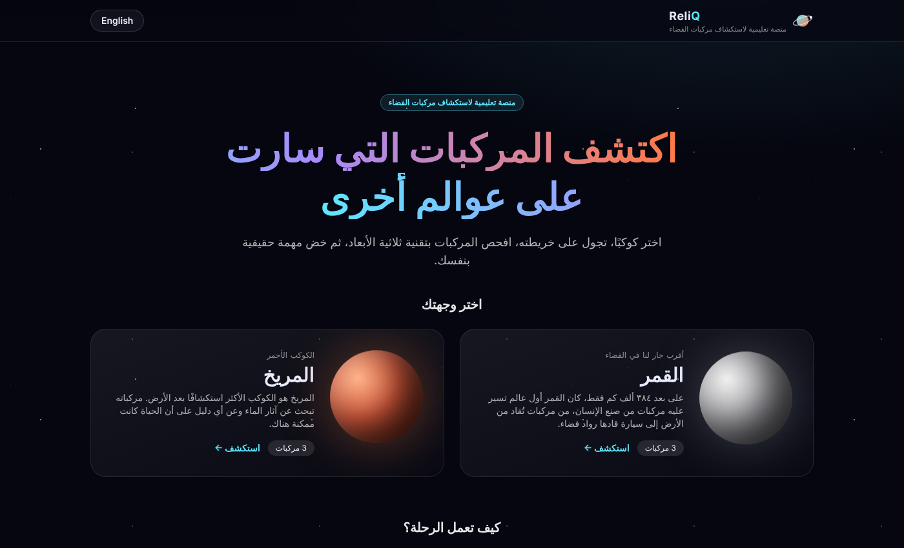
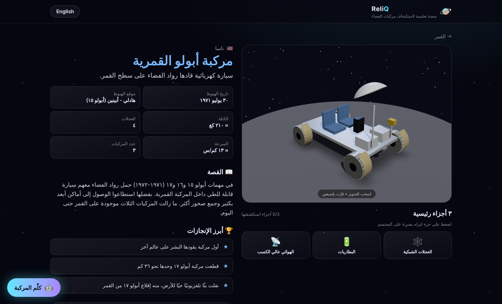
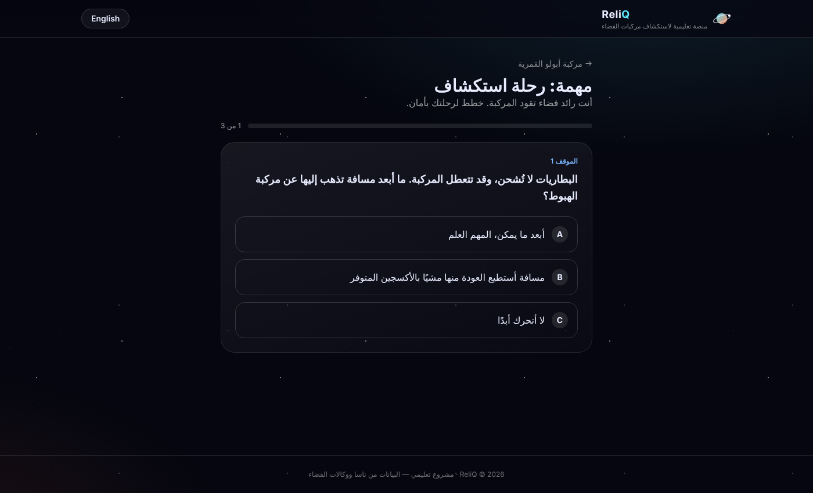

# ReliQ | ريليك 🚀

An interactive learning platform that helps students aged 14–18 explore the rovers that drove on the Moon and Mars.
Students pick a planet, find rovers on an interactive map, inspect each rover in 3D, ask an AI chatbot questions, and finish a short mission.

منصة تعليمية تفاعلية لطلاب ١٤–١٨ سنة، تعرّفهم على المركبات التي استكشفت القمر والمريخ.

**الرحلة:** اختيار الكوكب ← خريطة تفاعلية ← مركبة 3D + ٣ أجزاء رئيسية ← شات بوت ← مهمة قصيرة

## 📸 Screenshots

**Home: choose a planet**


**Rover page: 3D model, key facts, and AI chatbot**


**Mission: short decision-based quiz**


---

## ▶️ التشغيل على Windows

### ١. ثبّت البرامج مرة وحدة
- **Node.js (LTS)** من https://nodejs.org
- **VS Code** من https://code.visualstudio.com
- تأكد في PowerShell:
  ```
  node -v
  npm -v
  ```

### ٢. افتح المشروع
نزّل المشروع من الزر الأخضر **Code ← Download ZIP** وفك الضغط، ثم افتح المجلد في VS Code
(**File ← Open Folder**). افتح الطرفية من **Terminal ← New Terminal**.

### ٣. ثبّت المكتبات
```
npm install
```

### ٤. فعّل الشات بوت (Gemini)
1. ادخل على https://aistudio.google.com/apikey وأنشئ مفتاحًا مجانيًا.
2. انسخ الملف `.env.example` وسمّ النسخة `.env.local`.
3. ضع مفتاحك داخل `.env.local`:
   ```
   GEMINI_API_KEY=المفتاح_هنا
   ```
> ⚠️ لا ترفع `.env.local` على GitHub أبدًا (المشروع يتجاهله تلقائيًا).

### ٥. شغّل الموقع
```
npm run dev
```
افتح المتصفح على **http://localhost:3000**

> إذا ظهر خطأ `running scripts is disabled` شغّل في PowerShell:
> `Set-ExecutionPolicy -Scope CurrentUser RemoteSigned`

---

## 🌍 النشر على الإنترنت (Vercel مجانًا)
1. ارفع المشروع على GitHub.
2. ادخل https://vercel.com وسجّل بحساب GitHub ← **Add New Project** ← اختر `reliq`.
3. في **Environment Variables** أضف `GEMINI_API_KEY`.
4. اضغط **Deploy** وتحصل على رابط الموقع.

---

## 🗂️ هيكل المشروع

```
app/
  page.tsx                    الصفحة الرئيسية (اختيار الكوكب)
  explore/[planet]/page.tsx   صفحة الخريطة
  rover/[id]/page.tsx         صفحة المركبة (3D + الأجزاء + الشات)
  rover/[id]/mission/page.tsx صفحة المهمة
  api/chat/route.ts           خادم الشات بوت (المفتاح السري هنا فقط)
components/
  HomeView, ExploreView, PlanetMap   الواجهة والخريطة (Leaflet)
  RoverView, RoverViewer, RoverModel  عارض 3D (React Three Fiber)
  MissionView                        المهمة والنتيجة
  ChatBot                            نافذة المساعد
data/
  planets.ts   بيانات الكواكب + روابط خرائط ناسا
  rovers.ts    كل محتوى المركبات (عربي + إنجليزي)
lib/
  i18n.tsx     تبديل اللغة + اتجاه الصفحة RTL/LTR
  progress.ts  حفظ تقدم الطالب في المتصفح
```

## ✏️ تعديلات شائعة
- **إضافة مركبة:** انسخ كائن مركبة في `data/rovers.ts` وعدّل النصوص والإحداثيات والأسئلة.
- **تعديل نصوص الواجهة:** `lib/i18n.tsx`.
- **تغيير الألوان:** `app/globals.css` داخل `@theme`.

## 🧩 استخدام مجسمات ناسا الرسمية (اختياري)
المجسمات الحالية مصنوعة بالكود لتعمل بدون تحميل. لاستخدام ملفات `.glb` من
https://science.nasa.gov/3d-resources/ ضعها في `public/models/` واستبدل `<RoverModel>` في
`components/RoverViewer.tsx` بـ `useGLTF("/models/اسم-الملف.glb")` من مكتبة `@react-three/drei`.

## 🔐 الأمان
- مفتاح Gemini موجود في الخادم فقط ولا يصل للمتصفح.
- الخادم يتحقق من كل رسالة (النوع والطول) ويحدد ١٠ أسئلة بالدقيقة لكل زائر.
- تعليمات المساعد تحصره في مواضيع الفضاء وبأسلوب مناسب للأعمار ١٤–١٨.
- لا يوجد تسجيل دخول ولا تُجمع بيانات شخصية.

## 🛠️ التقنيات
Next.js · TypeScript · Tailwind CSS · Leaflet + NASA Trek · Three.js / React Three Fiber · Google Gemini API

## 📜 المصادر
الخرائط: NASA Trek (Moon Trek / Mars Trek). المحتوى مبني على معلومات ناسا ووكالات الفضاء.
